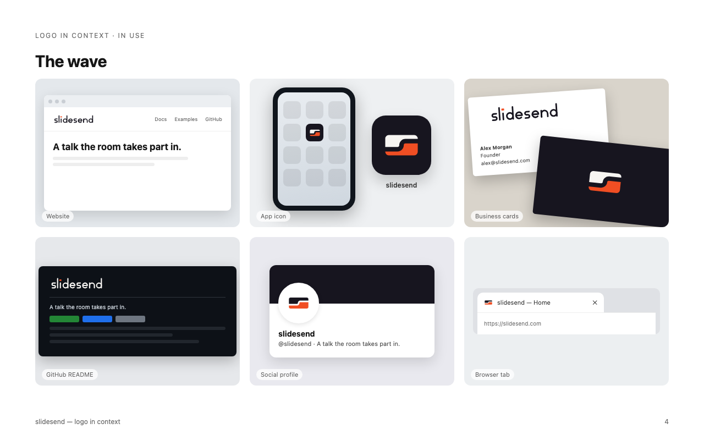

# slidesend · Logo guide

The complete logo kit for slidesend: the mark, the wordmark, every file and
the rules for using them. Why the brand exists, and what the mark has to
carry, is told in [`copy/slidesend-story.md`](../../copy/slidesend-story.md).



## 1. The mark: "the wave"

A slide split by a wave into two halves. The upper half is the **desk**, where
a person steers the talk. The lower half is the **stage**, which the room sees.
The two are apart and still one slide. The wave is the connection over the
network, and its step is the send.

**Construction.** A 16:9 rectangle (216 × 122 on a 256 canvas) with a corner
radius of 20, a gap of 18 and two quarter arcs of radius 18. The mark is
point-symmetric: turned 180° it is the same mark.

**The wordmark** is constructed, not typeset: a monoline lowercase with a
stroke of 18, round caps and bowls of radius 36. Its only coloured element is
the dot of the i, a small slide in the spotlight colour. The name stays one
word and is always lowercase. Both s look the same, and neither is ever
accented or set apart.

**The symbol or the wordmark, never both.** A surface shows one or the other.
There is no combined lockup.

## 2. Files

Everything below is generated. Never edit an SVG by hand: change
`scripts/build-slidesend`, then run it and `scripts/render-logos slidesend`.

| Path | What it is | Use it for |
|---|---|---|
| `svg/slidesend-symbol-dark.svg` | the mark, full colour | light backgrounds, 48 px and up |
| `svg/slidesend-symbol-light.svg` | the mark, full colour | dark backgrounds, 48 px and up |
| `svg/slidesend-symbol-sm-{dark,light}.svg` | small cut: wider, gap and radii opened up | 16–32 px |
| `svg/slidesend-wordmark-{dark,light}.svg` | the wordmark | headers, documents, decks |
| `mono/*-{black,white}.svg` | one-colour versions of all three | print, embossing, single-colour contexts |
| `app-icon/slidesend-app-icon.svg` | small cut on an ink tile | app stores, home screens, web manifest |
| `favicon/slidesend-favicon.svg` | adaptive favicon | browser tabs; follows light/dark |
| `favicon/*.png`, `*.ico`, `slidesend-apple-touch-180.png` | rendered favicons | legacy browsers, iOS |
| `png/`, `mono/*.png`, `app-icon/*.png` | rendered PNGs | where SVG is not accepted |
| `social/slidesend-social.png` | 1200 × 630 link preview | Open Graph / Twitter cards |
| `in-context/` | the mark on screens, print and at an event, plus the test sheet | judging and presenting the identity |

`dark` is dark artwork for light backgrounds, `light` is light artwork for
dark backgrounds.

**On a web page:**

```html
<link rel="icon" href="/slidesend-favicon-dark.ico" sizes="32x32">
<link rel="icon" href="/slidesend-favicon.svg" type="image/svg+xml">
<link rel="apple-touch-icon" href="/slidesend-apple-touch-180.png">
<meta name="theme-color" content="#17151F">
```

## 3. Clear space

Keep a quarter of the symbol's height free on every side. Around the
wordmark, keep its x-height (the height of the small s) free. The clear space
scales with the logo; it is never a fixed distance.

## 4. Minimum size

| Version | Screen | Print |
|---|---|---|
| Symbol | 48 px high | 10 mm wide |
| Small cut | 16 px (favicon) to 32 px | 6 mm wide |
| Wordmark | 96 px wide | 20 mm wide |

## 5. Colour

| Name | HEX | RGB | CMYK (approx.) | Role |
|---|---|---|---|---|
| Ink | `#17151F` | 23 21 31 | 26 32 0 88 | the desk half, the wordmark, dark backgrounds |
| Spotlight | `#F04E23` | 240 78 35 | 0 68 85 6 | the stage half, the i-dot |
| Paper | `#F7F5F2` | 247 245 242 | 0 1 2 3 | the desk half on dark, light backgrounds |

The CMYK values are calculated, not proofed in print. The Pantone match is to
be set by the printer against a swatch book.

**Contrast.** Spotlight has 3.6:1 on white and 5.0:1 on ink. That is enough
for graphics (3:1), not for running text. Text and controls use the theme's
accent from `tokens/slidesend.css`: `#CC3510` on light (5.1:1 on white) and
spotlight itself on dark.

**Approved pairs**

- full colour on white or paper
- the `-light` artwork on ink
- one-colour white on spotlight
- one-colour black on white

**Not approved:** full colour on ink (the desk half disappears) and full
colour on spotlight (the stage half disappears).

## 6. Don'ts

- Don't stretch, rotate or mirror the mark.
- Don't move the halves apart, show one half alone or swap their colours.
- Don't close the gap or fill it with anything but the background.
- Don't add shadows, outlines, gradients or effects.
- Don't put the symbol and the wordmark side by side.
- Don't use the full symbol below 48 px. Use the small cut there.
- Don't retype the wordmark in a font.

## 7. In context

| File | Shows |
|---|---|
| [`01-brief.png`](in-context/01-brief.png) | the brief the mark answers |
| [`02-the-mark.png`](in-context/02-the-mark.png) | the idea, the wordmark and the sizes |
| [`03-screens.png`](in-context/03-screens.png) | website, app icon on a phone, business cards, README, social profile, browser tab |
| [`04-print-and-event.png`](in-context/04-print-and-event.png) | speaker badge, laptop sticker, T-shirt, signage, tote bag, social profile |
| [`05-test-sheet.png`](in-context/05-test-sheet.png) | sizes from 16 px, pixel test, backgrounds, one colour, blur, mirror and rotation |

Names, addresses and domains in the mockups (such as "Alex Morgan" and
"slidesend.com") are placeholders from the mockup templates, not real
contacts or domains. The product lives at nxsflow.com/slidesend.
